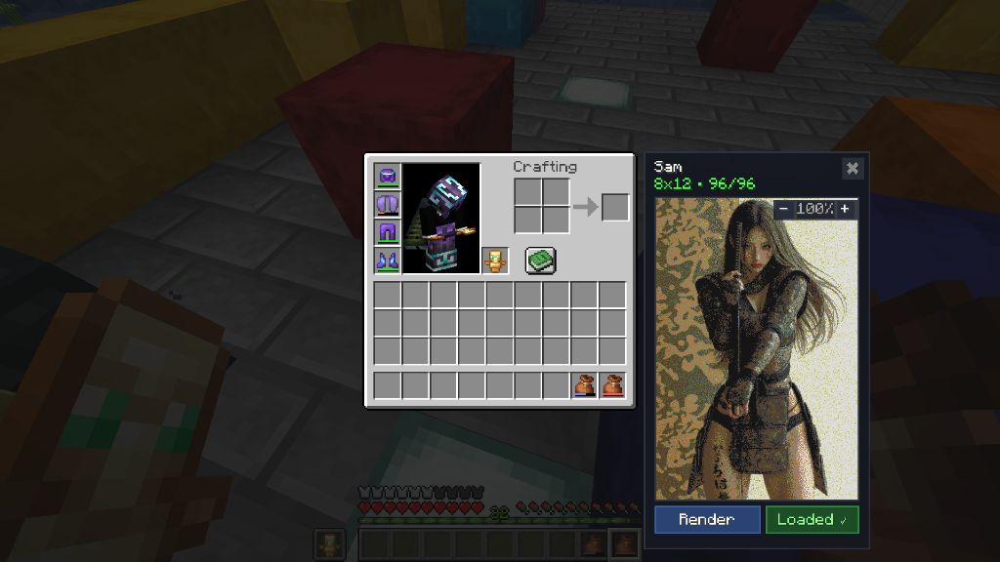
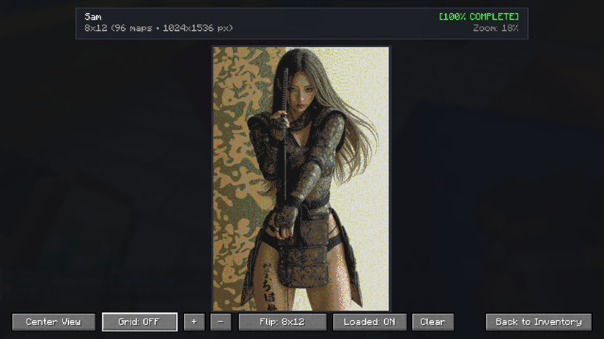

# Bundle Sorter

A client-side [Meteor Client](https://meteorclient.com/) addon for Fabric and Minecraft 26.2 that collects, sorts, deduplicates, and previews map-art bundles.

## Features

- **Bundle collector:** moves matching filled maps from opened containers into inventory bundles.
- **Chest sorter:** retrieves coordinate-named map tiles in grid order across chests and shulker boxes.
- **Duplicate extractor:** separates duplicate map tiles into an empty bundle.
- **Map-art viewer:** stitches bundle contents into an inventory side panel or fullscreen preview.
- **Safety controls:** configurable action delays and cursor recovery help avoid inventory desynchronisation.

## Screenshots

### Inventory preview



### Fullscreen viewer



## Requirements

- Minecraft `26.2`
- Fabric Loader `0.19.3` or newer
- Meteor Client for Minecraft 26.2
- Java 25 or newer

## Installation

1. Install Fabric Loader and Meteor Client for Minecraft 26.2.
2. Download the latest Bundle Sorter JAR from the repository's Releases page.
3. Place the JAR in your Minecraft instance's `mods` directory.
4. Start Minecraft and configure the modules under the **Bundle Sorter** Meteor category.

## Building

Clone the repository and run:

```shell
./gradlew build
```

On Windows:

```powershell
.\gradlew.bat build
```

The add-on JAR is generated in `build/libs/`.

## Project structure

```text
src/main/java/       Java source and mixins
src/main/resources/  Fabric metadata and mixin configuration
gradle/               Gradle wrapper
docs/screenshots/     README images
```

## Privacy

Bundle Sorter runs client-side and does not include telemetry or analytics. Inventory actions still communicate with the Minecraft server as part of normal gameplay.

## License

No license has been selected yet. Add a license before accepting external contributions or redistributions.
